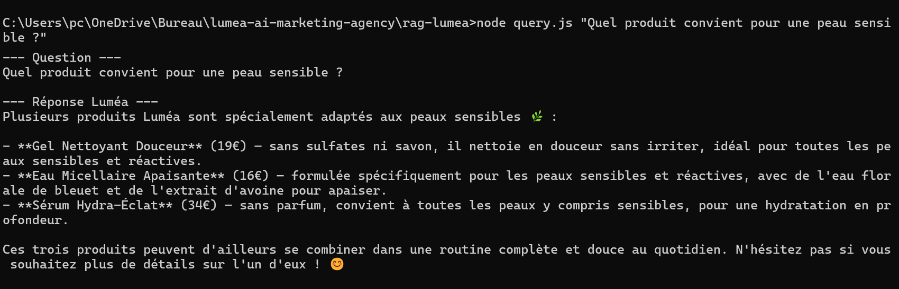
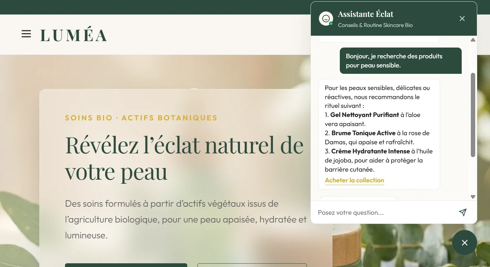

# Luméa — AI Marketing Agency

Projet réalisé dans le cadre de mon M2 Data Marketing  (INSEEC, 2025-2026), consistant à concevoir un écosystème marketing complet piloté par l'IA pour une marque fictive de skincare, **Luméa**.

Le projet démontre l'intégration de plusieurs briques d'IA générative : RAG (Retrieval-Augmented Generation), agent de création de contenu autonome, automatisation marketing via n8n, et développement rapide d'interface.

## Sommaire

- [Le client fictif : Luméa](#le-client-fictif--luméa)
- [Architecture du projet](#architecture-du-projet)
- [Stack technique](#stack-technique)
- [Livrable 1 — Chatbot RAG](#livrable-1--chatbot-rag)
- [Livrable 2 — Agent de contenu Instagram](#livrable-2--agent-de-contenu-instagram)
- [Livrable 3 — Workflow n8n de nurturing email](#livrable-3--workflow-n8n-de-nurturing-email)
- [Livrable 4 — Landing page](#livrable-4--landing-page)
- [Installation](#installation)
- [Variables d'environnement](#variables-denvironnement)
- [Limites et pistes d'amélioration](#limites-et-pistes-damélioration)

## Le client fictif : Luméa

Marque de skincare bio vendue en direct au consommateur (DTC), 4 soins formant un rituel en trois étapes (gel nettoyant, brume tonique, sérum à la vitamine C, crème hydratante). Cible : 25-40 ans sensibles à la clean beauty, panier moyen 45€. Problématique : scaler l'acquisition et le support client sans recruter, tout en professionnalisant la présence sociale.

## Architecture du projet

```
lumea-ai-marketing-agency/
├── rag-lumea/                   # Livrable 1 : chatbot RAG (Node.js, Chroma, Claude)
│   ├── data/                    # base de connaissances : fiches produits et FAQ
│   ├── embeddings.js
│   ├── ingest.js
│   ├── query.js
│   ├── .env.example
│   └── package.json
├── instagram-agent-lumea/       # Livrable 2 : agent de contenu Instagram
│   ├── agent.js
│   ├── n8n-workflow-instagram-agent.json
│   ├── products.json
│   ├── .env.example
│   └── package.json
├── n8n workflows/               # Livrables 2 et 3 : exports JSON des workflows n8n
├── landing page/                # Livrable 4 : site vitrine, formulaire et assistant de démonstration
├── docs/                        # captures du projet
├── documentation-detaillee-lumea.docx
├── Presentation-Lumea-AI-Marketing-Agency.pptx
└── README.md
```

## Stack technique

| Brique | Outil | Rôle |
|---|---|---|
| LLM | Claude (API Anthropic) | Génération des réponses du chatbot et du contenu Instagram |
| Vector store | Chroma (local) | Stockage des embeddings de la base de connaissances |
| Embeddings | Modèle multilingue local (Xenova/transformers) | Vectorisation gratuite, sans dépendance API tierce |
| Orchestration | n8n Cloud | Nurturing email et agent de contenu Instagram |
| Base de données | Airtable | Leads et file d'attente de contenu à valider |
| Landing page | HTML / CSS / JS | Vitrine, assistant de démonstration, formulaire de capture |
| Hébergement | Netlify | Déploiement public de la landing page |
| Versionning | GitHub | Archivage et partage du code source |

## Livrable 1 — Chatbot RAG

Base de connaissances de 7 documents (les 4 fiches produits de la landing page, le rituel matin et soir, la livraison et les retours, l'engagement de marque), découpés en 15 chunks (500 caractères, chevauchement 50) via un `RecursiveCharacterTextSplitter`, vectorisés avec un modèle d'embeddings **multilingue local** (`paraphrase-multilingual-MiniLM-L12-v2`) et stockés dans Chroma. Les 10 chunks les plus pertinents sont transmis à Claude avec un prompt système strict imposant de répondre uniquement à partir du contexte fourni et de reconnaître une absence d'information plutôt que d'halluciner.

**Difficulté résolue, et mesurée :** le premier modèle d'embeddings (anglophone, `all-MiniLM-L6-v2`) retrouvait mal les bons passages en français. Pour le vérifier, un jeu de test de 10 questions de clients, avec les fiches attendues fixées à l'avance, compare les deux modèles sur la recherche de passages (`npm run evaluate`, script `rag-lumea/compare-models.mjs`, sans appel à Claude) :

| Indicateur | Modèle anglais | Modèle multilingue |
|:---|---:|---:|
| Bon passage en 1re position | 3/10 | **4/10** |
| Bon passage dans le top 3 | 5/10 | **10/10** |
| MRR (qualité moyenne du classement, 1 = parfait) | 0,48 | **0,67** |

Le modèle multilingue a donc été retenu : il place toujours un bon passage dans les trois premiers, alors que le modèle anglais le classe parfois au-delà de la 10e place (14e pour « Vos produits sont-ils testés sur les animaux ? »). Le premier résultat est souvent la fiche du rituel matin et soir : elle cite tous les produits et contient souvent une partie de la réponse, mais elle n'est pas comptée comme bonne réponse, puisque les fiches attendues ont été fixées avant le test. Limite : 10 questions forment un petit échantillon ; pistes d'amélioration : élargir le jeu de test et essayer une recherche hybride (sémantique et par mots-clés).

*Le catalogue de la base de connaissances est le même que celui de la landing page : le chatbot ne peut conseiller que des produits réellement présentés sur le site.*



*Exemple : les produits cités, leurs prix, leurs formats et la précaution d'usage de l'Élixir proviennent tous des fiches de la base de connaissances.*

```
cd rag-lumea
npm install --legacy-peer-deps
chroma run --path chroma_data --host localhost --port 8000   # dans un terminal à part
npm run ingest                                                # indexation de la base de connaissances
node query.js "Quel produit convient pour une peau sensible ?"
```

## Livrable 2 — Agent de contenu Instagram

Agent générant des posts Instagram au format structuré (accroche, corps, CTA, hashtags, prompt image), avec deux implémentations : un script Node.js autonome (`agent.js`) et un workflow n8n (`n8n-workflow-instagram.json`) qui se déclenche tous les 2 jours, sélectionne un produit dans la rotation des 8 références, appelle l'API Claude et enregistre le résultat dans Airtable avec le statut "À valider". Aucune publication automatique : chaque post est relu par un humain avant diffusion (garde-fou contre un contenu inapproprié).

```
cd Instagram-Agent
npm install
node agent.js
```

## Livrable 3 — Workflow n8n de nurturing email

Séquence de 5 emails déclenchée par le formulaire de la landing page :

| Délai | Contenu |
|---|---|
| J0 (immédiat) | Bienvenue + guide de routine offert |
| J+2 | Focus sur le produit consulté |
| J+5 | Preuve sociale (témoignages) |
| J+9 | Code promotionnel (-10%) |
| J+14 | Dernière relance avant expiration |

Avant chaque email (sauf le premier), le workflow vérifie dans Airtable si le lead a déjà acheté ; si oui, la séquence s'arrête (sortie à la conversion).

## Livrable 4 — Landing page

Identité visuelle de la marque (palette verts/argile, typographie serif), hero avec étiquette produit stylisée, présentation de la gamme, frise interactive routine matin/soir, assistant de démonstration à réponses prédéfinies et formulaire de capture de leads connecté au webhook n8n. Déployée sur Netlify.



**Prochaine étape :** relier l'assistant de la landing page au moteur RAG (livrable 1) via une fonction serverless, pour qu'il réponde à partir de la base de connaissances.

## Installation

```bash
git clone https://github.com/JpNioule-maker/lumea-ai-marketing-agency.git
cd lumea-ai-marketing-agency/RAG-Lumea && npm install
cd ../Instagram-Agent && npm install
```

## Variables d'environnement

Chaque module possède son propre `.env` (non versionné, voir `.gitignore`), basé sur `.env.example` :

```
ANTHROPIC_API_KEY=your_key_here
```

> ⚠️ Ne jamais commiter les fichiers `.env`. Vérifié : absents de l'historique Git.

## Limites et pistes d'amélioration

| Limite constatée | Piste d'amélioration |
|---|---|
| Emails parfois classés en spam (domaine récent, sans réputation) | Authentifier le domaine avec SPF, DKIM, DMARC |
| L'agent Instagram génère mais ne publie pas automatiquement | Choix assumé (humain dans la boucle) ; nécessiterait un compte Business validé par Meta |
| Seul le prompt image est généré, pas l'image elle-même | Connecter une API de génération d'image (Stability AI, Replicate) |

---

**Auteur :** Jean Philippe NIOULE — Master 2 Data Marketing INSEEC
